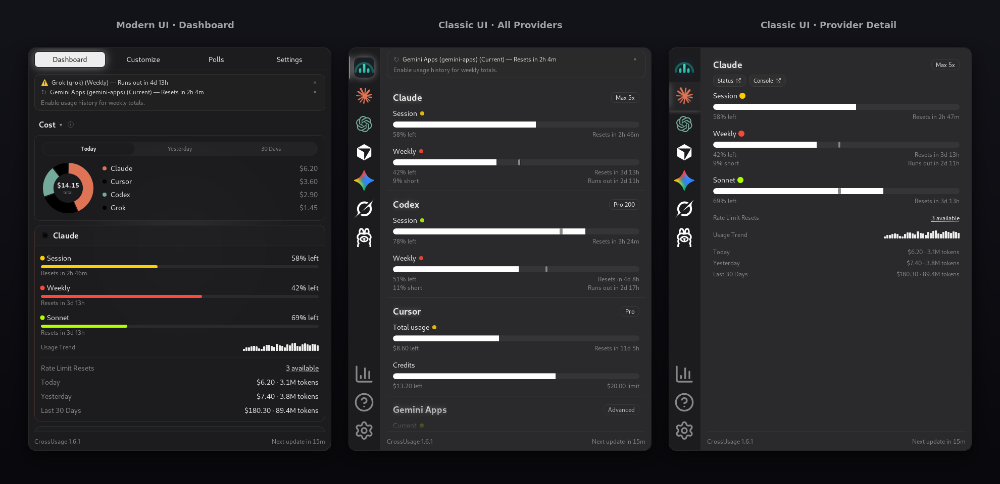

# CrossUsage

Menu-bar app for AI coding subscription usage — one panel, progress bars, no dashboard digging.

**Fork of [OpenUsage](https://github.com/robinebers/openusage)** by [Robin Ebers](https://github.com/robinebers). Credit the upstream project when you share or redistribute this work. This repo is the **Tauri app for Linux and Windows**. Upstream **0.7+** is a **Swift native macOS** app — use [upstream releases](https://github.com/robinebers/openusage/releases/latest) for macOS GUI. Maintainer porting notes: [docs/FORK-UPSTREAM.md](docs/FORK-UPSTREAM.md).

| | |
|---|---|
| **Releases** | [github.com/barramee27/crossusage/releases](https://github.com/barramee27/crossusage/releases/latest) |
| **Upstream** | [github.com/robinebers/openusage](https://github.com/robinebers/openusage) |
| **Site** | [crossusage.dev](https://crossusage.dev) |

**Versioning:** CrossUsage uses **`MAJOR.MINOR.PATCH`** (e.g. `1.0.10`). See [docs/VERSIONING.md](docs/VERSIONING.md) for when to bump each part. Upstream OpenUsage `0.6.x` is tracked in the changelog only, not in our app version.



## Download

Pick assets from the [latest release](https://github.com/barramee27/crossusage/releases/latest):

| Platform | Typical files |
|----------|----------------|
| **Windows** | `*_x64-setup.exe` (installer), `*_windows_amd64_onefile.exe` (portable) |
| **Linux** | `*_amd64.deb`, AppImage, or RPM |
| **macOS GUI** | [OpenUsage](https://github.com/robinebers/openusage/releases/latest) |
| **macOS / Linux CLI** | `crossusage-cli_*_….tar.gz` (see [Install](#install)) |

Desktop packages include **`crossusage-cli`** when built with the CLI sidecar.

## Install

**Linux / macOS** (`install.sh` — same command on both)

```bash
# Linux: desktop (.deb / AppImage / RPM) + CLI when the package includes it
curl -fsSL https://raw.githubusercontent.com/barramee27/crossusage/feat/linux-windows-native-support/scripts/install.sh | bash

# macOS: CLI only (no desktop .dmg in this fork — GUI → upstream OpenUsage)
curl -fsSL https://raw.githubusercontent.com/barramee27/crossusage/feat/linux-windows-native-support/scripts/install.sh | INSTALL_MODE=cli bash
```

**Windows** (PowerShell)

```powershell
irm https://raw.githubusercontent.com/barramee27/crossusage/feat/linux-windows-native-support/scripts/install.ps1 | iex
```

Linux **CLI-only** without a desktop package: add `INSTALL_MODE=cli` to the first command. Details: **[INSTALL.md](INSTALL.md)**.

## What you get

- Tray panel with usage bars, badges, and refresh on a schedule you choose
- **Classic or Modern UI** — pick at first run or in Settings → Appearance; same providers in both ([0.7 port spec](docs/OPENUSAGE-0.7-UI-SPEC.md))
- Global shortcut to show/hide the panel
- Plugin-based providers (ship updates without rebuilding core logic)
- Optional **local usage history** (Settings → *Usage history*, SQLite on disk only)
- **Usage insights** on the home panel (pace warnings, tightest quota, next reset, 7-day rollup when history is enabled)
- **Pace burn-rate alerts** for primary quota lines (Settings → Usage Alerts)
- **Cursor billing usage table** on provider detail (`usage-stats` / cstats parity)
- **History CSV export** and `GET /v1/history/*` on the local API (with usage history enabled)
- **[Local HTTP API](docs/local-http-api.md)** on `127.0.0.1:6736` while the app runs
- Optional **[HTTP/SOCKS proxy](docs/proxy.md)** via `~/.crossusage/config.json`

## Providers

- **Multi-account for all providers** — add Work/personal rows per provider in Settings (API keys + OAuth); credentials encrypted at rest. See **[multi-account credentials](docs/providers/multi-account-credentials.md)**.

| Provider | Docs |
|----------|------|
| Amp | [amp](docs/providers/amp.md) |
| Antigravity / Antigravity CLI / Antigravity IDE | [antigravity](docs/providers/antigravity.md) · [cli](docs/providers/antigravity-cli.md) · [ide](docs/providers/antigravity-ide.md) |
| Claude | [claude](docs/providers/claude.md) |
| Codex | [codex](docs/providers/codex.md) |
| Command Code | [command-code](docs/providers/command-code.md) |
| Copilot | [copilot](docs/providers/copilot.md) |
| CrofAI | [crofai](docs/providers/crofai.md) |
| Cursor | [cursor](docs/providers/cursor.md) |
| Cursor Nightly | [cursor](docs/providers/cursor.md) (separate install at `~/.config/Cursor Nightly` on Linux) |
| DeepSeek | [deepseek](docs/providers/deepseek.md) |
| Factory / Droid | [factory](docs/providers/factory.md) |
| Fireworks AI | [fireworks-ai](docs/providers/fireworks-ai.md) |
| Gemini Apps | [gemini-apps](docs/providers/gemini-apps.md) |
| Grok | [grok](docs/providers/grok.md) |
| JetBrains AI Assistant | [jetbrains-ai-assistant](docs/providers/jetbrains-ai-assistant.md) |
| Kiro | [kiro](docs/providers/kiro.md) |
| Kimi Code | [kimi](docs/providers/kimi.md) |
| MiniMax | [minimax](docs/providers/minimax.md) |
| Neuralwatt | [neuralwatt](docs/providers/neuralwatt.md) |
| Ollama | [ollama](docs/providers/ollama.md) |
| OpenCode Go | [opencode-go](docs/providers/opencode-go.md) |
| OpenRouter | `plugins/openrouter` (API key: `OPENROUTER_API_KEY`) |
| Perplexity | [perplexity](docs/providers/perplexity.md) |
| Synthetic | [synthetic](docs/providers/synthetic.md) |
| Devin | [devin](docs/providers/devin.md) |
| Z.ai | [zai](docs/providers/zai.md) |

New provider? [Fork issues](https://github.com/barramee27/crossusage/issues) for Linux/Windows packaging; [upstream issues](https://github.com/robinebers/openusage/issues) for core/plugin API.

## CLI

Terminal UI and scripts share the same plugin engine as the desktop app.

```bash
crossusage-cli              # dashboard (default)
crossusage-cli list           # table
crossusage-cli probe          # JSON
crossusage-cli export --format csv
crossusage-cli usage-stats --provider cursor
crossusage-cli --help
```

Build from clone: `cargo build -p crossusage-cli`. If plugins are missing, use `INSTALL_MODE=cli` or set `CROSSUSAGE_RESOURCES` to a tree with `bundled_plugins/` (see [`paths.rs`](crates/crossusage-core/src/paths.rs)).

## Develop

This fork currently uses source builds for updates. In-app binary updates are
disabled until a fork-owned release channel and signing keys are configured.
Provider usage refreshes continue normally.

**Requirements:** [Bun](https://bun.sh), Rust, platform deps for [Tauri v2](https://v2.tauri.app/start/prerequisites/).

Linux uses a native StatusNotifierItem tray through KSNI; AppIndicator libraries
are no longer required. Primary click toggles the window, middle-click shows
stats, and right-click opens the usage summary and actions menu. The desktop
must provide a StatusNotifier host (for example, a panel with a tray enabled).
Windows and macOS retain their native Tauri tray implementations.

With [just](https://just.systems), Node.js and npm installed, use the shortcuts below.
The recipes use `npm exec --yes --package=bun -- bun` for Bun-dependent hooks, so
a global Bun installation is optional (the first use may download Bun). With a
global installation, use `just bun=bun dev` or `just bun=bun setup`.

| Command | Action |
| --- | --- |
| `just` | List commands |
| `just setup` | Install frontend dependencies and fetch Rust dependencies with lockfiles |
| `just dev` | Desktop development with hot reload; incremental debug builds for app and CLI sidecar |
| `just build` | Native release build, frontend and bundled resources |
| `just run` | Start the existing `target/release/crossusage` build |
| `just diagnose` | Linux GDB capture; press Ctrl+C once if the app freezes |
| `just test` | Frontend tests; optional Vitest arguments |
| `just test-rust` | Rust core and CLI tests; optional Cargo arguments |
| `just cli list` | Run a CLI command from source |
| `just bundle` | Platform installer bundles via Tauri; optional Tauri build arguments |

`just run` keeps the app in the foreground: output remains visible and Ctrl+C
stops it. Environment-discovery shells run in their own sessions so they cannot
suspend the application's terminal job.

`just dev` prepares the debug CLI sidecar automatically, sharing the native Cargo
cache with the app. The first start compiles missing dependencies; subsequent
starts only compile changed Rust code. It does not build release artifacts or
production frontend assets. `just build` creates the optimized release build
and does not require updater signing keys. `just bundle` uses the existing
Tauri packaging configuration and its platform/signing requirements. Recipes
inherit your environment, including `CARGO_HOME`, `CARGO_NET_OFFLINE` and explicit
graphics overrides. The Linux diagnostic recipe uses its existing clean-launch
environment. The development and build hooks synchronize bundled plugins,
including the generated Cursor Nightly source, preserving timestamps when the
contents are unchanged. Run `npm run test:build-scripts` for the build-hook tests.

The existing commands remain available:

```bash
bun install
bun run bundle:plugins
bun run tauri:dev      # desktop
bun run tauri:build    # release bundle — use npm script, not legacy `cargo tauri` v1
```

```bash
cargo run -p crossusage-cli -- list
```

App icon source: [`branding/crossusage-icon-color.svg`](branding/crossusage-icon-color.svg) → `rsvg-convert` + `bunx tauri icon`.

**Tests:** `bun run test` · **Plugins:** [Plugin API](docs/plugins/api.md) · **Contributing:** [CONTRIBUTING.md](CONTRIBUTING.md)

## License

[MIT](LICENSE) — fork contributors; original OpenUsage © Robin Ebers and contributors.

Inspired by [CodexBar](https://github.com/steipete/CodexBar) by [@steipete](https://github.com/steipete).
